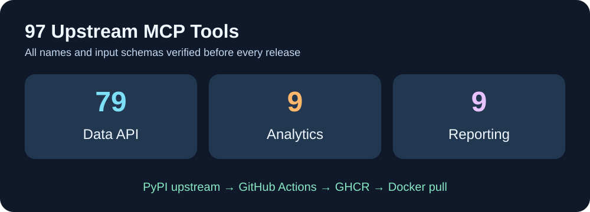

<p align="center"></p>
# Cloud9-YouTube-MCP

**97 outils MCP YouTube, image GHCR précompilée et compatibilité IPv4 avec l’API Google.**

[English](README.md) · Français · [简体中文](README.zh-CN.md)

Le serveur Python [`youtube-complete-mcp`](https://github.com/sigvardt/youtube-mcp) reste **strictement upstream** : ce dépôt ajoute uniquement un emballage Docker HTTP, et un contournement ciblé de la résolution IPv6 pour YouTube Data API. Analytics et Reporting utilisent leurs API originales.



Le CI GitHub reconstruit les dernières versions officielles, vérifie les **97 outils et leurs schémas d’entrée** par une session MCP HTTP réelle sans réseau externe, puis publie une image GHCR. Les prochaines mises à jour nécessitent seulement un `docker pull` après certification.

## Démarrage

```bash
git clone https://github.com/GodsQuantum/Cloud9-YouTube-MCP.git
cd Cloud9-YouTube-MCP
cp .env.example .env
docker compose -f compose.example.yaml up -d
```

Point d’accès local : `http://127.0.0.1:8765/mcp`. La configuration `./data` est persistante. Connecter ses propres comptes par les mécanismes OAuth upstream.

**Ne jamais exposer ce MCP sur Internet sans passerelle authentifiée** : après OAuth, les outils peuvent accéder aux données de la chaîne. L’autorisation des mutations reste bloquée par défaut tant que le handle autorisé n’est pas fourni. Aucune configuration personnelle n’est incluse.

Licence MIT pour l’emballage, licence MIT originale conservée pour le paquet upstream.
