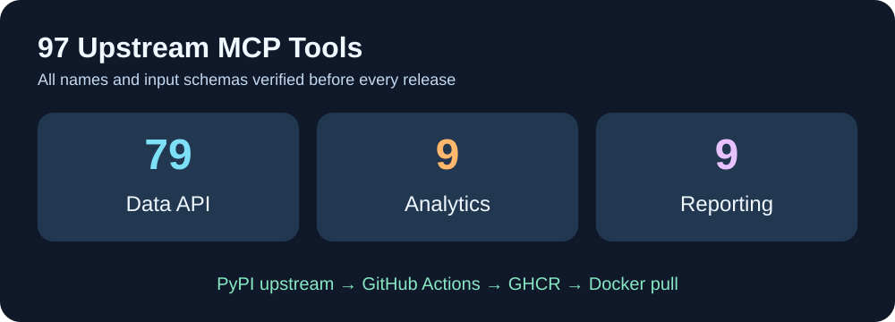

<p align="center"></p>
<h1 align="center">Cloud9-YouTube-MCP</h1>
<p align="center"><strong>Unmodified upstream YouTube MCP · 97 tools · IPv4-safe Google API endpoint · GHCR prebuilt</strong></p>
<p align="center">English · <a href="README.fr.md">Français</a> · <a href="README.zh-CN.md">简体中文</a></p>
<p align="center"><a href="https://github.com/GodsQuantum/Cloud9-YouTube-MCP/actions/workflows/release.yml"></a> </p>

Cloud9-YouTube-MCP packages the **unmodified** upstream MIT [`youtube-complete-mcp`](https://github.com/sigvardt/youtube-mcp) Python server into a portable HTTP Docker image. We preserve the full 97-tool Data/Analytics/Reporting API contract. This project is not affiliated with Google or YouTube.

## What Cloud9 adds

- **Prebuilt public GHCR** images. Deployments only pull; no Python compilation or long package installs on production hosts.
- A minimal isolated compatibility wrapper: when `youtube.googleapis.com` resolves to an IPv6-only service in an IPv4-only container, use Google's supported `www.googleapis.com` frontend for **YouTube Data v3 only**. Analytics and Reporting endpoints are unchanged.
- HTTP Streamable MCP endpoint on port 8765, suitable for a trusted MCP gateway.
- Preserve upstream's channel mutation guard, token-store configuration and existing OAuth flows. **No credentials, cookies, handles, account identifiers, API keys, media files or OAuth tokens are present in this repository or images**.
- GitHub Actions tracks PyPI `youtube-complete-mcp` latest and Python 3.12 slim, verifies a real, network-isolated MCP handshake and the **97 baseline tool schemas** before updating `:latest`. New additive tools may appear, but no existing tool can silently disappear or change its input schema.

<p align="center"></p>

## Install

```bash
git clone https://github.com/GodsQuantum/Cloud9-YouTube-MCP.git
cd Cloud9-YouTube-MCP
cp .env.example .env
docker compose -f compose.example.yaml up -d
```

The example publishes `127.0.0.1:8765` **only on localhost**. Configure OAuth accounts using upstream's documented login flow and persist them in `./data`. Set `YOUTUBE_MCP_MUTATING_ALLOWED_HANDLE` explicitly if mutation is authorized; leave it empty to retain the fail-closed guard.

For trusted local clients, MCP endpoint: `http://127.0.0.1:8765/mcp`.

**Do not publish the MCP endpoint publicly without your own authenticated gateway.** It can expose private YouTube data after OAuth. The container does not supply user auth by itself.

## Release and rollback

The upstream Python package and Node-free Python base are rebuilt on GitHub, including a daily upstream check; only a passing schema/HTTP test publishes a new `:latest`. Use immutable `sha-<commit>` image tags to pin a known-good deployment. The workflow's build occurs on GitHub, never in the user's production LXC.

## License

Our Docker recipe, compatibility adapter and docs: MIT. The Python upstream is authored by Joakim Sigvardt and licensed under MIT; its copyright and license remain with its author.
