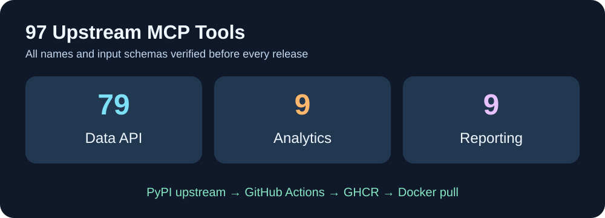

<p align="center"></p>
# Cloud9-YouTube-MCP

**97 个 YouTube MCP 工具、预构建 GHCR Docker 镜像，以及适用于 IPv4 容器网络的 Google API 兼容方案。**

[English](README.md) · [Français](README.fr.md) · 简体中文

此项目使用**未经修改**的上游 [`youtube-complete-mcp`](https://github.com/sigvardt/youtube-mcp) Python 服务器，并添加小型 HTTP Docker 包装层。当容器网络无法访问 YouTube Data API 的 IPv6 地址时，只将 Data v3 API 路由到 Google 支持的 IPv4 前端。Analytics 与 Reporting 接口保持原样。



GitHub Actions 每天检查上游 PyPI 更新，使用真实 HTTP MCP 会话验证**97 个工具名称与输入 Schema**，只有测试通过后才发布新镜像。部署机器无需编译，只需拉取 GHCR 镜像。

## 安装

```bash
git clone https://github.com/GodsQuantum/Cloud9-YouTube-MCP.git
cd Cloud9-YouTube-MCP
cp .env.example .env
docker compose -f compose.example.yaml up -d
```

本地端点：`http://127.0.0.1:8765/mcp`。按照上游文档执行 OAuth 登录并保存账户数据。必须明确配置授权的频道标识才能允许修改操作。

**不要把未经认证的 MCP 端点直接暴露到互联网**。仓库及镜像不包含账号、Cookie、OAuth 令牌、API 密钥或个人文件。打包配方和上游软件包均采用 MIT 许可证，并尊重原作者版权。
